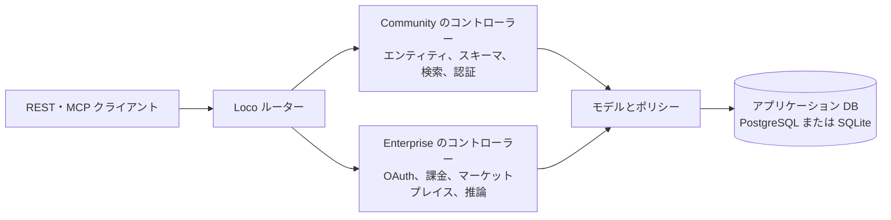
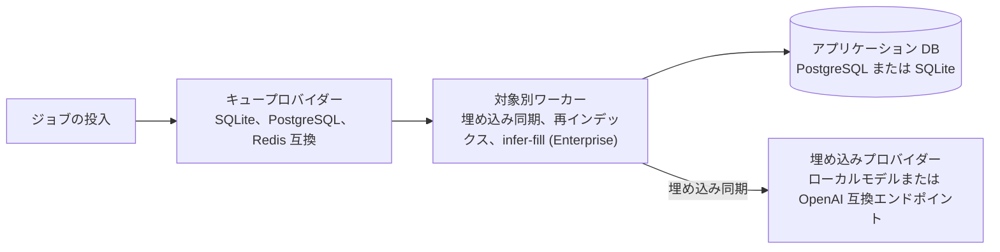

# Yorishiro (依り代)

**[English](README.md)** | 日本語

自分のデータ構造を定義し、キーワードだけでなく意味で検索できるナレッジストア。

## できること

- **自分のデータ構造を定義する**
  - フィールド、バリデーションルール、エンティティ間のリレーションを持つエンティティ型を作成できます。データモデルが変わってもコード修正は不要。
  - APIでスキーマ、エンティティ型、リレーションを管理。
  - JSONLファイルからデータをインポート。

- **意味で検索する**
  - 「配送に関する顧客クレーム」といった説明を入力すると、正確に同じ言葉がなくても関連するレコードが見つかります。
  - ローカル埋め込み（multilingual-e5-base）またはOpenAI互換エンドポイントでのベクトル検索対応。
  - 埋め込みがまだ生成されていないレコードもキーワード検索でカバー。

- **AIツールに接続**
  - コミュニティモードでは、Claude、Cursor、他のMCP対応クライアントが組み込みMCPツールを使ってデータを検索・作成・管理できます。
  - ライセンスが有効なエンタープライズ環境では、originテンプレートの更新検出、プレビュー、マージのツールが追加されます。

- **REST API**
  - 標準HTTPエンドポイントで自動化できます。

- **チームで整理する**
  - テナントとワークスペース、ロールベースのアクセス制御でデータを適切に分割・共有できます。

## アーキテクチャ

### リクエストの流れ

### バックグラウンドジョブ

二つの図は同じアプリケーションを示しています。
Enterprise ビルドでは Community の機能にコントローラーとワーカーが加わります。
ライセンス対象の機能には有効なキーが必要です。
SQLite は単一テナント用です。
PostgreSQL では行レベルセキュリティでテナントを分離します。

## エディション

Community の機能は Enterprise でも利用できます。
Enterprise では次の機能が加わります。

| 機能 | コミュニティエディション(無料) | エンタープライズエディション |
|---|---|---|
| ワークスペースごとの埋め込みプロバイダ割り当て | — | 利用可能 |
| ワークスペースごとのLLM推論キー & fill | — | 利用可能 |
| テンプレートマーケットプレイス | — | 利用可能 |
| OAuth2 / OIDCログイン | — | 利用可能 |
| Stripe課金 | — | 利用可能 |

Enterprise の機能にはライセンスキーが必要です。

### MCPツール

利用できるツールと入力項目は [MCPツール](https://yorishiro-ai.github.io/wiki/ja/reference/mcp-tools/) を参照してください。

ライセンスが有効なエンタープライズ環境では、同ドキュメントに示すoriginテンプレート用ツールが追加されます。
コミュニティモードでは、これらのツールはMCP上に表示されず、呼び出すこともできません。

## クイックスタート

既定では SQLite を使うため、外部データベースは不要です。

1. Docker（記載のポート割り当てを使用）の場合は `http://localhost/`、パッケージまたはソースからの起動では `http://localhost:5150/` にアクセスし、セットアップウィザードでアカウントを作成します。
2. API キーを発行して、エンティティを作成します。

バックグラウンドキューを使うソースチェックアウトでは、サーバーとタグ付きワーカーを別々に起動します。
`cargo loco start` と `cargo loco start --worker=worker-target:shared` を実行してください。
他のターゲットについては、[ワーカーのターゲット](https://yorishiro-ai.github.io/wiki/ja/configuration/workers-and-queues/#ワーカーのターゲット)を参照してください。

インストール手順は [インストール](https://yorishiro-ai.github.io/wiki/ja/installation/) を参照してください。

## 設定

Yorishiro の設定には `config/<environment>.yaml` と、その設定ファイルから読み込む環境変数を使います。
`LOCO_ENV` で設定環境を選びます。
ソースからのローカル実行では `development`、パッケージと Docker では `production` を使います。
別の設定ディレクトリを使う場合は `LOCO_CONFIG_FOLDER` を指定してください。
アプリケーションデータは SQLite または PostgreSQL を利用できます。
キューの保存先は別に設定します。
アプリケーションのデータベースが SQLite の場合は別ファイルの SQLite キューか Redis 互換サービス、PostgreSQL の場合は PostgreSQL キューか Redis 互換サービスを使えます。
バックエンド変数を設定しない場合のみ、パッケージと Docker は SQLite の既定データを `/var/lib/yorishiro` に保存します。

## ドキュメント

| ドキュメント | 内容 |
|---|---|
| [インストール](https://yorishiro-ai.github.io/wiki/ja/installation/) | Docker、Docker Compose、deb/rpm、ソースからビルド |
| [設定](https://yorishiro-ai.github.io/wiki/ja/configuration/) | 全設定：埋め込み、検索クォータ、ログ、キューバックエンド |
| [キューのパブリッシャーの切り替え](https://yorishiro-ai.github.io/wiki/ja/operations/queue-publisher-cutover/) | 待機中の作業を新しいパブリッシャーのエポックへ移す |
| [SQLiteモード](https://yorishiro-ai.github.io/wiki/ja/guides/sqlite/) | 機能と制限 |
| [組み込みテンプレート](https://yorishiro-ai.github.io/wiki/ja/guides/templates/) | 組み込みテンプレートと非推奨の `worldbuilding` テンプレート |
| [AGENTS.md](AGENTS.md) | AI エージェント向けの開発規約 |

## ライセンス

[Business Source License 1.1](LICENSE) の下でライセンスされています。セルフホスティングは許可されています。2030-07-14 にこのバージョンはGNU General Public License Version 2.0以降に自動的に変換されます。
