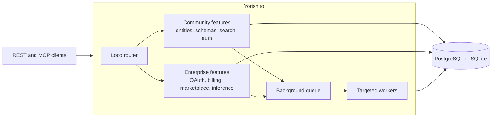

# Yorishiro (依り代)

**English** | [日本語](README.jp.md)

A knowledge store where you define your own data structures and search by meaning, not just keywords.

## What it does

- **Define your own data structures**
  - Create entity types with fields, validation rules, and cross-entity relations. No code changes needed when your data model evolves.
  - Manage schemas, entity types, and relations through the API.
  - Import data from JSONL files.

- **Search by meaning**
  - Type a description like "customer complaint about shipping" and find related records even if none of them contain those exact words.
  - Built-in embeddings: local (multilingual-e5-base) or any OpenAI-compatible endpoint.
  - Full-text fallback when embeddings are not yet available.

- **Connect to AI tools**
  - Community mode provides built-in MCP tools for Claude, Cursor, and other MCP-compatible clients to search, create, and manage your data.
  - A licensed enterprise deployment adds origin-template update discovery, preview, and merge tools.

- **REST API**
  - Automate everything with standard HTTP endpoints.

- **Organize with teams**
  - Tenants and workspaces with role-based access keep data scoped and shared as you choose.

## Architecture

The Enterprise build adds features to the Community base; licence-gated features require a valid key.
SQLite is single-tenant; PostgreSQL supports tenant isolation through row-level security.

## Editions

Everything you can do in ce is also available in ee. ee adds the following on top of ce:

| Feature | Community Edition(Free) | Enterprise Edition |
|---|---|---|
| Per-workspace embedding provider assignment | — | Available |
| Per-workspace LLM inference keys & fill | — | Available |
| Template marketplace | — | Available |
| OAuth2 / OIDC login | — | Available |
| Stripe billing | — | Available |

Enterprise features require a licence key.

### MCP tools

See [MCP tools](docs/en/mcp-tools.md) for available tools and their inputs.

A licensed enterprise deployment adds the origin-template tools shown in that document.
Those tools are not advertised or callable through MCP in community mode.

## Quick start

The default configuration uses SQLite, so no external database is required.

1. Open `http://localhost/` for Docker (with the documented port mapping), or `http://localhost:5150/` for packages and source runs, and create an account through the setup wizard.
2. Generate an API key and start creating entities.

For a source checkout using a background queue, run the server and tagged worker separately:
`cargo loco start` and `cargo loco start --worker=worker-target:shared`.

For installation instructions, see [docs/en/installation.md](docs/en/installation.md).

## Configuration

Configure Yorishiro with `config/<environment>.yaml` and the environment variables it reads.
`LOCO_ENV` selects the configuration environment; local source runs use `development`, while packages and Docker use `production`.
`LOCO_CONFIG_FOLDER` lets you use a different configuration directory.
Application data can use SQLite or PostgreSQL.
For a SQLite application database, choose a separate SQLite queue file or a Redis-compatible service; for PostgreSQL, choose a PostgreSQL queue or a Redis-compatible service.
With no backend variables set, package and Docker installations store the SQLite defaults under `/var/lib/yorishiro`.

## Documentation

| Document | Contents |
|---|---|
| [docs/en/installation.md](docs/en/installation.md) | Docker, Docker Compose, deb/rpm, and build from source |
| [docs/en/configuration.md](docs/en/configuration.md) | All settings: embedding, search quotas, logging, queue backends |
| [docs/en/sqlite.md](docs/en/sqlite.md) | SQLite mode: capabilities and limitations |
| [docs/en/templates.md](docs/en/templates.md) | Built-in templates and the deprecated `worldbuilding` template |
| [CONTRIBUTING.md](CONTRIBUTING.md) | Contributing guidelines |
| [AGENTS.md](AGENTS.md) | Notes for AI agents |

## License

Licensed under the [Business Source License 1.1](LICENSE). Self-hosting is permitted. On 2030-07-14 this version converts to the GNU General Public License, Version 2.0 or later.
